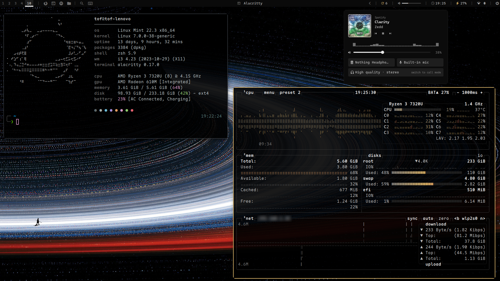

# dotfiles

Rice **i3** noir et monochrome sur Linux Mint, géré avec **GNU Stow**.



## Composants

| Rôle | Outil |
|---|---|
| Gestionnaire de fenêtres | [i3](https://i3wm.org) + [autotiling](https://github.com/nwg-piotr/autotiling) |
| Barre | [polybar](https://github.com/polybar/polybar) |
| Menus, lanceur, Alt+Tab | [rofi](https://github.com/davatorium/rofi) |
| Popups (lecteur média, CPU) | [eww](https://github.com/elkowar/eww) + [cava](https://github.com/karlstav/cava) |
| Compositeur | [picom](https://github.com/yshui/picom) |
| Notifications | [dunst](https://github.com/dunst-project/dunst) |
| Terminal / shell | [alacritty](https://alacritty.org) · zsh + oh-my-zsh + powerlevel10k |
| Éditeur | [neovim](https://neovim.io) (lazy.nvim, LSP via Mason, blink.cmp) |
| Fetch / moniteur | [fastfetch](https://github.com/fastfetch-cli/fastfetch) · [btop](https://github.com/aristocratos/btop) |
| Spotify | [spicetify](https://spicetify.app) + thème [glass](https://github.com/epxii/glass-theme) (assombri) |
| Divers | flameshot (captures) · CopyQ (presse-papier) · ranger · Firefox (userChrome) |

## Ce qu'il y a dedans

**Barre (polybar)**
- workspaces, raccourcis d'applis, lanceur et récap des raccourcis à gauche ; appli au focus au centre
- tiroir dépliable pour les stats système (disque, RAM utilisée / totale, CPU, température) ;
  clic sur le CPU : popup avec la charge de chaque cœur, façon htop
- bouton de mises à jour système (apt + flatpak) avec barre de progression ;
  réapplique spicetify si Spotify a été mis à jour
- volume en barre ; clic : popup média eww (pochette, titre, contrôles, visualiseur cava,
  choix de la sortie et du micro, bascule casque Bluetooth haute qualité / mode appel)
- wifi et Bluetooth avec leurs menus rofi maison (connexion, oubli `Alt+d`, scan…)
- menu d'alimentation (verrouiller / redémarrer / éteindre)

**i3**
- déplacement des fenêtres par échange avec la voisine (plus de sauts dus aux conteneurs imbriqués)
- `$mod+z` : tout le workspace en onglets, sans onglets imbriqués
- fenêtres flottantes centrées, coins arrondis et ombres (picom) seulement pour ce qui flotte
- Alt+Tab avec icônes : une entrée par appli, bascule sur sa fenêtre la plus récente

**Palette unique** — toutes les couleurs viennent de
[`theme/.config/theme/colors.json`](theme/.config/theme/colors.json) :

```sh
~/.config/theme/apply   # régénère les couleurs de polybar, rofi, eww, dunst, i3, btop, fastfetch et recharge tout
```

## Raccourcis principaux

`$mod` = Super. La liste complète est générée depuis la config i3 : icône clavier dans la barre.

| Raccourci | Action |
|---|---|
| `$mod+Enter` | terminal |
| `$mod+Space` | lanceur d'applications |
| `Alt+Tab` | changer d'application |
| `$mod+c` | historique du presse-papier |
| `$mod+q` | fermer la fenêtre |
| `$mod+h/j/k/l` · `$mod+Shift+h/j/k/l` | focus · déplacer (échange) |
| `$mod+z` | onglets / côte à côte |
| `$mod+Shift+Space` | flottant / tuilé |
| `$mod+f` | plein écran |
| `$mod+t` | btop |
| `Print` · `Shift+Print` | capture de zone · écran entier |
| `$mod+Shift+x` | verrouiller |
| `$mod+Shift+r` | redémarrer i3 |

## Installation

Pensé pour Debian / Ubuntu / Linux Mint.

```sh
git clone git@github.com:tloloum/dotfiles.git ~/dotfiles
cd ~/dotfiles
./install.sh            # paquets apt, polices, compilation d'alacritty et eww, liens stow
./install.sh --restow   # seulement (re)faire les liens
```

Chaque dossier de premier niveau est un paquet stow qui reflète `$HOME`
(`polybar/.config/polybar/…` → `~/.config/polybar/…`).

## Crédits

- Thème Spotify **glass** par [epxii](https://github.com/epxii/glass-theme) (MIT), assombri —
  voir [`SOURCE.md`](spicetify/.config/spicetify/Themes/glass/SOURCE.md)
- Thème Firefox **DownToneUI** — voir [`chrome/README.md`](chrome/README.md)
